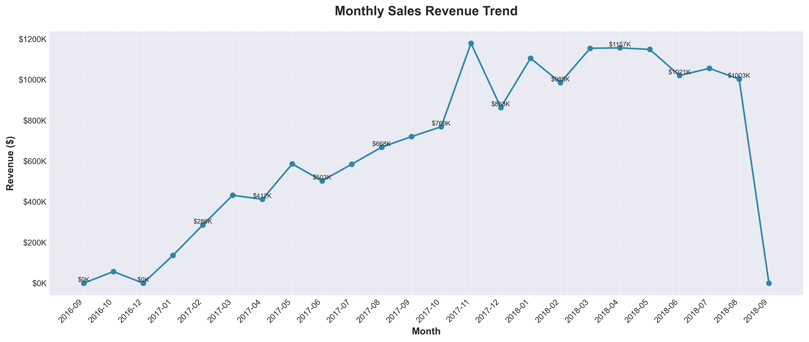

# E-Commerce Data Warehouse

End-to-end data warehouse built on the [Olist Brazilian e-commerce dataset](https://www.kaggle.com/datasets/olistbr/brazilian-ecommerce): data cleaning, a star-schema warehouse in PostgreSQL, an ETL pipeline, and business dashboards.

## Stack
Python (pandas, pygrametl, matplotlib), PostgreSQL, SQL

## Architecture
- **Star schema:** `fact_sales` plus the dimensions `dim_customer`, `dim_product`, `dim_seller`, `dim_payment` and `dim_date` (see `sql/create_tables.sql`)
- **Pipeline:** raw CSVs → cleaning → ETL (pygrametl) → PostgreSQL → dashboards

## Project structure
```
data/        Raw Olist CSV files
scripts/     clean_data.py, etl_pipeline.py, create_dashboards.py
sql/         Warehouse schema (create_tables.sql)
dashboards/  Generated charts (PNG)
Rapport.docx Full project report (French)
```

## How to run
1. Create a PostgreSQL database named `ecommerce_dw` and run `sql/create_tables.sql`.
2. Install dependencies: `pip install pandas numpy psycopg2-binary pygrametl matplotlib seaborn`
3. Set the DB password: `$env:DB_PASSWORD = "your_password"` (PowerShell) or `export DB_PASSWORD=your_password` (bash).
4. From the project root, run in order:
   ```
   python scripts/clean_data.py
   python scripts/etl_pipeline.py
   python scripts/create_dashboards.py
   ```

## Dashboards
The 10 charts are generated in `dashboards/`: monthly revenue, top categories, sales by state, payment methods, top sellers, quarterly comparison, delivery time analysis, and more.


